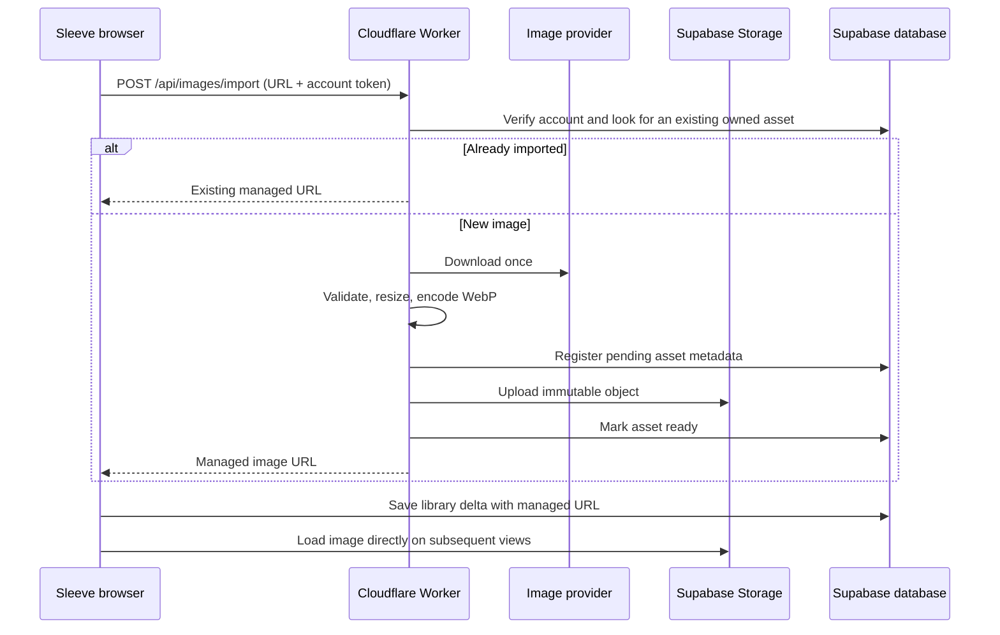

# Managed images

Sleeve imports album art, artist photos, and instrument pictures into its own
Supabase Storage bucket. You can still paste an external image URL or select an
image through album lookup. Signed-in saves download and optimize new selections
before saving the library. Demo libraries remain entirely in browser storage.

## How it works



The Worker is the importer; it does not sit in the image delivery path. Cloudflare
Images processes bytes at import time, while Supabase stores and serves the
result. The original provider is only needed for imports and the editor's initial
URL preview, not normal browsing after import.

Each stored image is:

- WebP, with transparency preserved and animations reduced to a still image.
- At most 768 pixels on either side, preserving aspect ratio without upscaling.
- Targeted at 50,000 bytes, with an enforced ceiling of 100,000 bytes.
- Initially encoded at quality 80. If necessary, the importer tries quality 65,
  then 640px/65, 512px/60, and 384px/55. It retains the smallest acceptable
  result if none reaches the target. Images that cannot fit are rejected.
- Stored once, without keeping the original bytes or generating thumbnails.
  WebP encoding removes source metadata and applies source orientation.

Inputs must be JPEG, PNG, GIF, WebP, or AVIF; SVGs are rejected. Downloads are
limited to 10 MB and 15 seconds including redirects, with at most four redirects.
Inputs are limited to 40 megapixels and 12,000 pixels per side. Hostnames and DNS
answers are checked for public destinations on every redirect. Literal IPs,
local names, credentials, and custom ports are rejected. Source requests never
receive the user's account token or cookies. Import requests are authenticated
and rate limited to 20 per minute per account at each Cloudflare location.

The `image_assets` table records the owning account, original URL, immutable
storage path, public URL, actual dimensions/bytes, and processing version. Existing
`artwork_url`, `photo_url`, and `image_url` columns hold the managed URLs, so image
rendering and offline caching use the same code as before. Album credits' embedded
artist/instrument image values are reconciled after import too.

## Set up Supabase

1. Run [the managed image migration](../supabase/migrations/20261116120000_managed_images.sql)
   in the project's SQL Editor, after the earlier migrations. It creates:
   - A **public** `library-images` bucket allowing only WebP objects up to 100 KB.
   - An asset registry with per-account metadata reads and server-only writes.
   - Triggers requiring owned, ready assets for new/changed image references.
   - A server-only function for safely claiming unused assets for cleanup.
2. Find the project URL and publishable key under your project's API settings.
   These must refer to the same Supabase project as the frontend's `VITE_` settings.
3. Find the legacy **service_role** key under API keys. This key is for the Worker
   only: never put it in a `VITE_` variable, frontend code, or Git. No S3 access
   keys, Storage policies, Edge Functions, or Supabase image-transformation plan
   are needed.

Public means anyone with an image URL can download it. It does not expose the
library records or the source-URL registry. Writes and deletions go through the
Worker using its service-role key. The migration deliberately grants no client
Storage writes; do not add broad write policies for this bucket.

## Set up Cloudflare and deploy

The repository's `wrangler.jsonc` now declares an `IMAGES` binding, the request rate
limiter, a daily cleanup schedule, and the Worker entry point. Keep your existing
Worker name. There is no separate image-storage resource to create on Cloudflare.

1. Sign in to Wrangler if needed: `npx wrangler login`.
2. Add the Worker settings using interactive prompts:

   ```sh
   npx wrangler secret put SUPABASE_URL
   npx wrangler secret put SUPABASE_PUBLISHABLE_KEY
   npx wrangler secret put SUPABASE_SERVICE_ROLE_KEY
   ```

   Paste the Supabase project URL, publishable key, and service-role key into the
   corresponding prompts. These are runtime settings, separate from the frontend
   `.env` values embedded during a build.

3. Deploy the app and Worker together with `npm run deploy`.
4. Sign in, edit an album's image URL, and save. Confirm that its displayed image
   URL begins with your Supabase project's
   `/storage/v1/object/public/library-images/` path. Inspect the bucket and
   `image_assets` table to see the optimized file and its metadata.

The [Images binding](https://developers.cloudflare.com/images/optimization/binding/)
uses Cloudflare's transformation service. The current Free allowance is
[5,000 unique transformations per month](https://developers.cloudflare.com/images/pricing/).
Changing output dimensions during compression can consume additional unique
transformations; repeated views use Supabase and consume none. Exceeding the
free transformation allowance prevents new imports until it resets or you change
plans. You do not need Cloudflare Images hosted-image storage.

Supabase currently includes [1 GB of storage](https://supabase.com/pricing) on Free,
shared across the project, plus separate cached and uncached egress allowances.
Approximately 10,000 maximum-size images fit before reserving headroom. Monitor
both storage and egress in the Supabase dashboard. Quotas belong to the project,
not each Sleeve account. Hosting copies removes dependency on source availability;
it does not change the source image's license or attribution requirements.

## Local development

For frontend-only work, `npm run dev` still works. Image importing requires the
Worker too. Put these settings in an ignored `.dev.vars` file in the repo root:

```dotenv
SUPABASE_URL=https://YOUR_PROJECT_REF.supabase.co
SUPABASE_PUBLISHABLE_KEY=YOUR_PUBLISHABLE_KEY
SUPABASE_SERVICE_ROLE_KEY=YOUR_SERVICE_ROLE_KEY
```

Use a development Supabase project when testing imports. `npm run cf:dev` builds
and runs the full app at `http://localhost:8787`. Alternatively, keep
`npx wrangler dev --port 8787` running alongside `npm run dev`; Vite proxies
`/api/images` to it. The local proxy rewrites same-origin Vite requests to the
Worker's origin, so both `localhost` and `127.0.0.1` Vite URLs work without relaxing
origin checks on the deployed Worker. Restart Vite after changing the proxy config.
Restart the Worker when changing its code/configuration if
necessary; frontend source edits are served by Vite.

Wrangler provides a local Images simulator. For verification against Cloudflare's
full transformation service, temporarily set `"remote": true` in the `images`
binding and authenticate Wrangler. Local tests do not require Cloudflare
credentials. Supabase requests still target whichever project `.dev.vars` names;
the image bucket is not emulated by Wrangler.

## Move existing external images

Old references continue to display and unrelated edits do not import them. This
keeps deployment and ordinary saves independent of a bulk migration. To migrate
an account's existing images after setup/deployment:

1. Sign in to Sleeve. In browser developer tools, find its Supabase auth entry in
   Local Storage (`sb-…-auth-token`) and copy the current `access_token` from its
   JSON value. This is a temporary account credential; do not share it.
2. In a local terminal, set `SUPABASE_URL`, `SUPABASE_PUBLISHABLE_KEY`, and
   `SLEEVE_URL` (the deployed app URL). Read the token without putting it into
   shell history:

   ```sh
   read -rs -p 'Account access token: ' SUPABASE_ACCESS_TOKEN
   export SUPABASE_ACCESS_TOKEN
   node scripts/migrate-images.mjs
   unset SUPABASE_ACCESS_TOKEN
   ```

   The other three settings must also be exported. This script requires Node
   22.18+ and the installed repo dependencies. It uses the account's token and
   existing RLS policies, not a service-role key.

3. Refresh Sleeve after the migration. If the token expires, repeat with a fresh
   token. Already migrated rows are skipped, so rerunning resumes the work.

The script pages through albums, artists, and instruments, imports images
sequentially, and updates each row only if its old URL is still unchanged.
Provider failures leave the old reference intact and are reported by record ID;
source URLs are not printed. Rate-limit responses are retried with a pause. A
nonzero exit code indicates failures to retry. Run separately for each account.
Migration is explicit; it never starts a surprise bulk download during login.

## Failure and cleanup behavior

A failed download or optimization stops that save, keeps the editor's input for
retry, and preserves the committed library. Clearing the image field lets the
user save without the image. A successful upload followed by a failed database
save is harmless: retries reuse a ready asset for the same account and source
URL, without downloading or encoding it again. Reusing a source URL deliberately
reuses its existing copy; select a different URL to replace an image.

There is no transaction spanning Storage and Postgres. The importer registers a
pending asset before uploading, then marks it ready after a successful upload.
Only ready assets can be reused or attached to a library row. A lost response or
failed upload leaves a tracked pending asset for cleanup; a retry can safely
start again. If the ready update succeeded but its response was lost, the retry
reuses that ready asset. This ordering ensures that uploaded objects have cleanup
metadata even when a save fails.

At 05:00 UTC daily, the Worker claims up to 100 unreferenced assets not imported
or reused for seven days. This includes canceled/failed saves and replaced/deleted
images. The database locks claims against saves and marks them as deleting, so a
save cannot attach an image about to be removed. The Worker deletes the objects
through the Storage API, then removes their registry rows. Failed deletions remain
marked and are retried the next day. Account deletion preserves registry entries
with a null owner so their objects can also be cleaned up. Referenced images are
never eligible for scheduled cleanup.

The seven-day window protects recent imports, not arbitrarily old open editors.
If an old draft contains a now-deleted managed URL, choose a fresh source URL.
Existing references to the same asset can be shared within an account; deleting
one reference does not delete an image still used elsewhere. Image paths change
on replacement, allowing a one-year browser cache lifetime without stale copies.

## Troubleshooting a deployed update

The app serves the latest HTML from the network on online navigation, with the
last completely precached build retained as the offline fallback. Existing open
tabs continue running their current code until reloaded.

If a deployment's save sends a third-party URL directly to `save_library_changes`
without first calling `/api/images/import`, an older frontend may still be loaded.
Try a private browser window to confirm. For a browser controlled by an older
service worker, unregister it under Developer Tools → Application → Service Workers,
close all Sleeve tabs/windows, and reopen the app. Keep Local Storage intact so
account sessions and drafts are retained. A normal cache refresh alone may not
replace an active service worker's cached app shell.

If `/api/images/import` succeeds but saving still fails, compare its returned URL
with the image fields in the save request. The asset must exist in `image_assets`
in the same project, belong to the signed-in user, have `ready_at` set, and have
`deleting_at` unset. A file in the bucket alone does not prove its registry entry
is ready. The Worker and frontend must target the same Supabase project.
